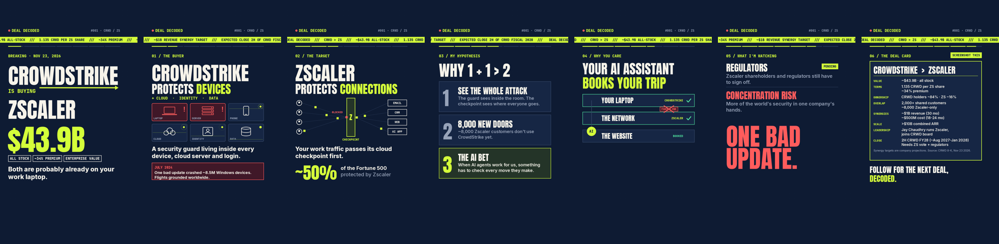

# Deal Decoded

**Subject:** Business · **Input:** 📰 news scout
**Premise:** $1B+ M&A announcements, explained for people who don't work in finance.
**Format:** 75–90 s talk track in six parts, ending with a deal card that's worth a screenshot. See [`deal-decoded-script`](../skills/deal-decoded-script) for the script and [`deal-decoded-video`](../skills/deal-decoded-video) for the video.
**Look:** navy `#0E1B33` + electric lime `#D4FF3A`, market-terminal style: scrolling deal ticker, condensed headlines, animated diagrams. No mascot on screen.
**Cadence:** a scout runs each weekday and drafts up to 2 scripts, each with a silent video. I pick, review and record the voiceover.
**Pipeline status:** Scout ✅ · Script ✅ · Video ✅ (silent; I add the voiceover) · Voiceover merge 🛠️

**Episodes:** [#003 Sanofi → Insmed](../episodes/deal-decoded/2026-11-24-003-sanofi-insmed.md)

