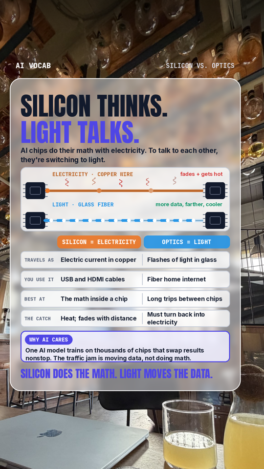

# animated-infographic

One animated TikTok infographic, in plain language, from a topic. No script and no voiceover: the creator gives a topic and gets back a 12-second looping MP4, a still PNG and a ready-to-paste caption with hashtags.



**What makes it different from [`course-explainer-video`](../course-explainer-video):** that skill makes a 60–90 s multi-scene video timed to the creator's voiceover. This one is a single frame that builds in and loops, so it needs almost nothing from the creator.

**House rules baked in:** the see-through frosted panel is centered top to bottom over the photo; clutter is cropped out of the photo rather than moving the panel; content stays clear of TikTok's button rail and caption area (`safe` mode shows them); each piece leads with one takeaway and ties every item to something people already use.

```bash
BG=photo.jpg OUT=out/silicon-vs-optics.mp4 python3 animated_infographic.py examples/silicon-vs-optics.py safe     # check layout
BG=photo.jpg OUT=out/silicon-vs-optics.mp4 python3 animated_infographic.py examples/silicon-vs-optics.py render   # mp4 + png + caption
```

It can also make a two-slide photo carousel (short teaser, then the answer) with `png` mode: see [`examples/silicon-vs-optics-carousel/`](examples/silicon-vs-optics-carousel/).

See [SKILL.md](SKILL.md) for the full instructions.
