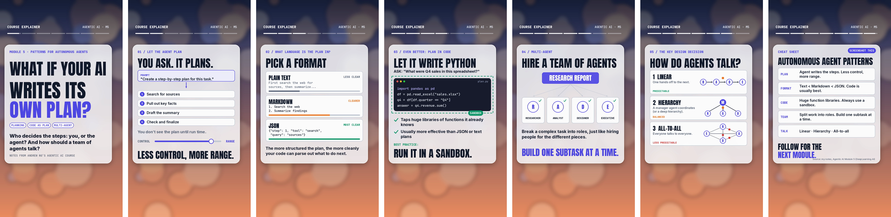

# Course Explainer: Video Renderer

**What it does:** turns the notes from one course module into a 60–90 second vertical TikTok. One Python file holds the house look; each video is a short file of scenes built from shared helpers. It renders the silent MP4 in about 40 seconds, and I record the voiceover to the scene start times.

**Why:** the earlier explainers were static text over a photo. This version keeps the frosted panel but adds a moving diagram for every idea, so the video teaches with the sound off.

**Design choices**
- **Frosted panel over a dusk gradient.** Generated in code, so every video matches and no photo shoot is needed (a photo can still be dropped in).
- **One idea, one animated diagram per scene:** plan steps that only appear at run time, clarity bars for plan formats, Python typing inside a sandbox, agents passing messages.
- **Hook up front, cheat sheet at the end.** The last scene is built to be screenshotted.
- **Safe zones built in.** Content stays clear of TikTok's search bar, side buttons and caption.

**Example:** [`agentic-ai-m5-autonomous-agents.py`](examples/agentic-ai-m5-autonomous-agents.py) (Andrew Ng's Agentic AI, Module 5: planning and multi-agent patterns).

**Used by:** [`learning-notes-intake`](../../agents/learning-notes-intake.md), after a note is picked for Course Explainers.
