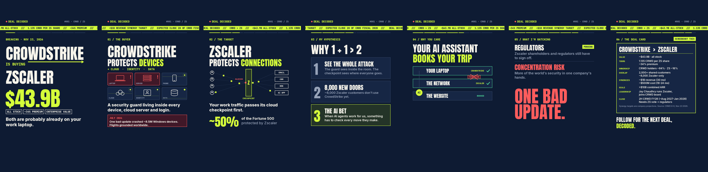

# Deal Decoded: Video Renderer

**What it does:** turns a fact-checked Deal Decoded script into an 86-second vertical TikTok video. A short JSON spec describes what goes on screen; one Python script draws every frame and encodes the MP4 in about 25 seconds. The video is silent on purpose: I record the voiceover myself, timed to the script.

**Why I built it:** the script skill made writing an episode fast, but making the visuals was still slow and inconsistent. Putting the series' look into code means every episode looks the same, and a new deal is a new spec rather than a new design job.

**Design choices**
- **Market-terminal look, not a slide deck.** Navy and electric lime, a scrolling ticker of real deal numbers, and a progress bar, so it reads as "markets" in the first second.
- **Animated diagrams for each company:** icon tiles or a "traffic through a checkpoint" flow, chosen per deal, so the analogy in the script has a picture.
- **The deal card is the payoff.** It's held for 10+ seconds with a "SCREENSHOT THIS" tag, and it labels company projections as projections.
- **Safe zones built in.** Everything stays clear of TikTok's search bar, side buttons and caption.
- **Long text shrinks to fit.** Each section stacks below the one before it, so a wordier deal doesn't break the layout.
- **Facts only from the script.** The spec is filled from the fact-checked talk track; nothing on screen is looked up separately.

**Examples:** [`crwd-zs.json`](examples/crwd-zs.json) (CrowdStrike → Zscaler, #001) and [`sanofi-insmed.json`](examples/sanofi-insmed.json) (Sanofi → Insmed).

**Used by:** the [`deal-decoded-scout`](../../agents/deal-decoded-scout.md) agent, after [`deal-decoded-script`](../deal-decoded-script) writes the script.
